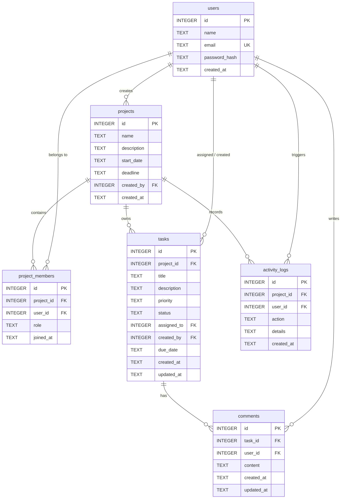
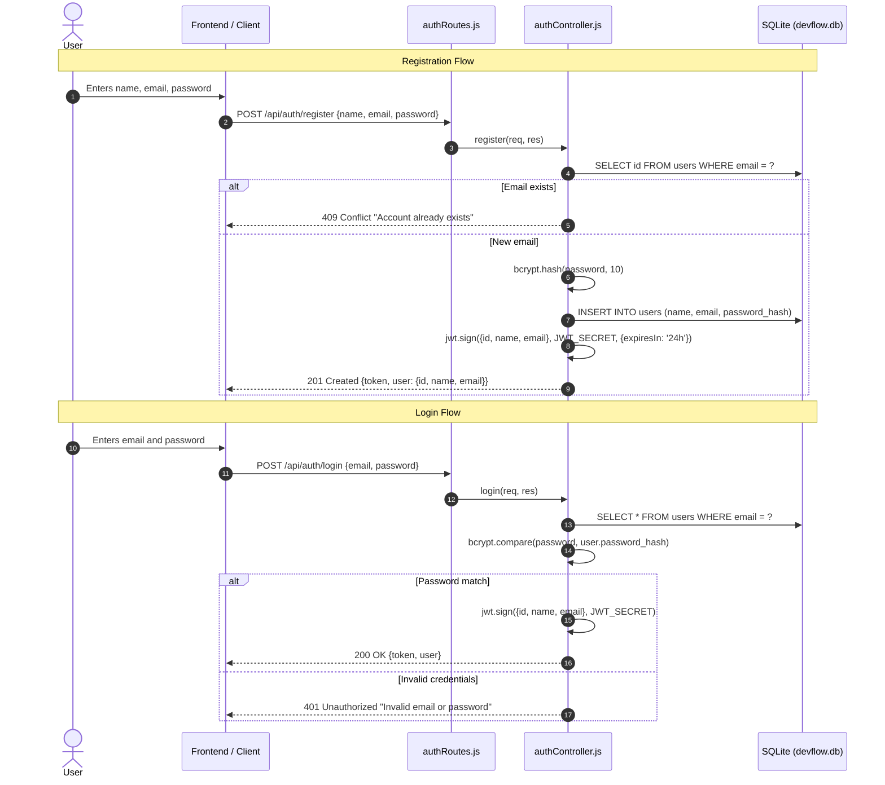

# DevFlow — Backend Architecture and Execution Flow

This document details the backend architecture, request execution lifecycle, security mechanisms, database queries, and REST API specification for **DevFlow**. It is designed to help student developers understand and explain the backend during project evaluations and demonstrations.

---

## 1. Backend Folder Structure

The backend code is organized into modular layers where each directory has a single, clear responsibility:

```
server/
├── config/
│   ├── auth.js               # JWT secret and token expiration configuration
│   └── db.js                 # SQLite connection using better-sqlite3 (WAL mode & foreign keys)
├── database/
│   ├── init.js               # DDL schema script: creates tables, foreign keys, and indexes
│   ├── seed.js               # Populates database with sample users, projects, tasks, and comments
│   └── devflow.db            # Local SQLite database file (created automatically)
├── middleware/
│   ├── auth.js               # Verifies JWT Bearer token and attaches req.user
│   ├── authorize.js          # Project membership and role-based access checks (Owner/Admin/Member)
│   ├── errorHandler.js       # Centralized error handler returning consistent JSON responses
│   └── validate.js           # Reusable input validation and string sanitization helpers
├── controllers/
│   ├── authController.js     # User registration, login, and profile retrieval logic
│   ├── projectController.js  # Project CRUD and progress computation
│   ├── memberController.js   # Project team member additions and removals
│   ├── taskController.js     # Task creation, updates, status transitions, and assignments
│   ├── commentController.js  # Comment CRUD with ownership checks
│   ├── dashboardController.js# Aggregated statistics and dashboard metrics
│   └── activityController.js # Audit logs for project actions
├── routes/
│   ├── authRoutes.js         # /api/auth endpoints
│   ├── projectRoutes.js      # /api/projects endpoints
│   ├── memberRoutes.js       # /api/projects/:projectId/members endpoints
│   ├── taskRoutes.js         # /api/projects/:projectId/tasks and /api/tasks endpoints
│   ├── commentRoutes.js      # /api/tasks/:taskId/comments and /api/comments endpoints
│   ├── dashboardRoutes.js    # /api/dashboard endpoint
│   └── activityRoutes.js     # /api/projects/:projectId/activity endpoints
├── services/
│   └── activityLogger.js     # Helper function to insert activity history entries
├── test-backend.js           # 35-test integration suite testing all endpoints and permissions
├── app.js                    # Express application configuration, CORS, and route mounting
├── server.js                 # Server entry point: runs initDatabase() and listens on PORT
├── package.json              # Backend dependencies and scripts
└── .env                      # Environment variables (PORT, JWT_SECRET)
```

---

## 2. Request Lifecycle: How Express Receives and Processes Requests

When a client (frontend or API test runner) makes an HTTP request, it flows through a sequential pipeline:

```mermaid
flowchart TD
    Client["Client / Frontend (Axios)"] -->|HTTP Request| Server["server.js (Node.js HTTP Server)"]
    Server --> ExpressApp["app.js (Express Application)"]
    ExpressApp --> CORS["CORS & express.json() Middleware"]
    CORS --> Router["Express Router (routes/*.js)"]
    Router --> AuthMiddleware["auth.js (JWT Verification)"]
    AuthMiddleware --> AuthorizeMiddleware["authorize.js (Role / Member Check)"]
    AuthorizeMiddleware --> Controller["Controller (controllers/*.js)"]
    Controller --> ActivityLog["activityLogger.js"]
    Controller --> DB["better-sqlite3 (devflow.db)"]
    DB --> Controller
    Controller -->|JSON Response| Client
    Controller -.->|Error thrown next(err)| ErrorHandler["errorHandler.js (Centralized Error Handler)"]
    ErrorHandler -->|Error JSON Response| Client
```

### Detailed Pipeline Stages:

1. **HTTP Listener (`server.js`)**: Starts the HTTP server on port `5000` (or `process.env.PORT`) after verifying database tables are initialized via `initDatabase()`.
2. **Global Middleware (`app.js`)**:
   - `cors()` allows cross-origin requests from the React frontend.
   - `express.json()` parses incoming JSON request bodies into `req.body`.
   - Request logger logs method, path, status, and duration for each request.
3. **Routing (`routes/*.js`)**: Express matches the path (e.g., `/api/projects/1/tasks`) and passes control to the route definition.
4. **Authentication Middleware (`middleware/auth.js`)**: Extracts `Authorization: Bearer <token>`, verifies the JWT signature, and attaches the user payload (`id`, `name`, `email`) to `req.user`.
5. **Authorization Middleware (`middleware/authorize.js`)**: For project-scoped routes, verifies that `req.user.id` is present in `project_members` for the given `projectId`.
6. **Controller (`controllers/*.js`)**: Executes business logic, runs prepared SQL queries using `better-sqlite3`, logs activities, and formats the response.
7. **Error Handler (`middleware/errorHandler.js`)**: Any unhandled error passed to `next(err)` is captured and formatted into `{ error: true, message: err.message }`.

---

## 3. Database Schema and Relationships

DevFlow uses SQLite (`better-sqlite3`) with foreign key enforcement and Write-Ahead Logging (`WAL`) enabled.



### Table Integrity and Constraints:
- **Foreign Keys**: Enabled on every connection using `db.pragma('foreign_keys = ON')`.
- **Cascading Deletes**: 
  - Deleting a project cascades down to delete all its `project_members`, `tasks`, and `activity_logs`.
  - Deleting a task cascades down to delete its `comments`.
  - If a user is deleted, their assigned tasks have `assigned_to` set to `NULL` (`ON DELETE SET NULL`), preventing orphaned tasks.
- **Check Constraints**:
  - `project_members.role` CHECK IN ('Owner', 'Admin', 'Member')
  - `tasks.priority` CHECK IN ('Low', 'Medium', 'High')
  - `tasks.status` CHECK IN ('To Do', 'In Progress', 'Done')
- **Unique Constraints**:
  - `users.email` is UNIQUE.
  - `project_members(project_id, user_id)` is UNIQUE (preventing duplicate memberships).

---

## 4. Authentication Flow

Authentication is stateless and uses JSON Web Tokens (JWT) along with bcrypt password hashing:



### How Protected Routes Identify the User:
1. Client stores token in localStorage and attaches `Authorization: Bearer <token>` to headers.
2. In `server/middleware/auth.js`:
   ```javascript
   const token = authHeader.split(' ')[1];
   const decoded = jwt.verify(token, JWT_SECRET);
   const user = db.prepare('SELECT id, email, name FROM users WHERE id = ?').get(decoded.id);
   req.user = { id: user.id, email: user.email, name: user.name };
   next();
   ```
3. Downstream controllers can safely access `req.user.id`, `req.user.name`, and `req.user.email`.

---

## 5. Authorization and Role Security Flow

DevFlow enforces strict project-level isolation. Even if a user has a valid JWT, they cannot view or modify data for a project they do not belong to.

### Authorization Middleware (`server/middleware/authorize.js`):
1. **`requireProjectMember`**:
   - Reads `req.params.projectId`.
   - Checks `SELECT role FROM project_members WHERE project_id = ? AND user_id = ?`.
   - If not found, immediately returns HTTP `403 Forbidden` (`You are not a member of this project`).
   - If found, attaches `req.memberRole = member.role` to the request object and calls `next()`.
2. **`requireProjectRole(...roles)`**:
   - Ensures the user is a member and that `roles.includes(member.role)`.
   - For example: `requireProjectRole('Owner')` for project deletion; `requireProjectRole('Owner', 'Admin')` for adding/removing members or updating project settings.

### Resource-Level Authorization Rules:
- **Task Assignment**: `createTask` and `updateTask` explicitly verify that the `assigned_to` user is an active member in `project_members` of that specific project before saving. Non-members cannot be assigned tasks.
- **Comment Editing/Deleting**: `commentController.js` verifies `comment.user_id === req.user.id`. Users can only edit or delete their own comments.

---

## 6. Activity Logging System

The activity log system (`server/services/activityLogger.js`) tracks project history for transparency and auditing:

```javascript
function logActivity(projectId, userId, action, details = '') {
  try {
    const stmt = db.prepare(`
      INSERT INTO activity_logs (project_id, user_id, action, details)
      VALUES (?, ?, ?, ?)
    `);
    stmt.run(projectId, userId, action, details);
  } catch (err) {
    console.error('⚠️ Failed to log activity:', err.message);
  }
}
```

### Actions Automatically Tracked:
- Project creation (`Created project`)
- Project updates (`Updated project`)
- Team member additions (`Added member`)
- Team member removals (`Removed member`)
- Task creation (`Created task`)
- Task status changes / Kanban movements (`Updated task status`)
- Task reassignments (`Assigned task`)
- Comments added (`Added comment`)

---

## 7. Complete REST API Endpoint Reference

| Method | Endpoint | Auth Required | Permissions | Description |
|---|---|---|---|---|
| `GET` | `/api/health` | No | None | Server health status and uptime |
| `POST` | `/api/auth/register` | No | None | Register new user (name, email, password) |
| `POST` | `/api/auth/login` | No | None | Login user, returns JWT and user profile |
| `GET` | `/api/auth/me` | Yes | Authenticated user | Retrieve profile of currently logged-in user |
| `GET` | `/api/projects` | Yes | Member | List all projects the logged-in user belongs to |
| `POST` | `/api/projects` | Yes | Authenticated user | Create project; assigns creator as Owner |
| `GET` | `/api/projects/:projectId` | Yes | Project Member | Get project details, task metrics, member count |
| `PUT` | `/api/projects/:projectId` | Yes | Owner, Admin | Update project name, description, deadlines |
| `DELETE` | `/api/projects/:projectId` | Yes | Owner | Delete project and cascade-delete all related data |
| `GET` | `/api/projects/:projectId/members` | Yes | Project Member | List all project team members and their roles |
| `POST` | `/api/projects/:projectId/members` | Yes | Owner, Admin | Add existing registered user by email |
| `DELETE` | `/api/projects/:projectId/members/:userId` | Yes | Owner, Admin | Remove member and unassign their tasks |
| `GET` | `/api/projects/:projectId/tasks` | Yes | Project Member | List project tasks (supports `status`, `priority`, `assigned_to` filters) |
| `POST` | `/api/projects/:projectId/tasks` | Yes | Project Member | Create a task assigned to a project member |
| `GET` | `/api/tasks/:taskId` | Yes | Project Member | Retrieve single task with creator and assignee info |
| `PUT` | `/api/tasks/:taskId` | Yes | Project Member | Update task title, description, priority, assignee, status |
| `DELETE` | `/api/tasks/:taskId` | Yes | Project Member | Delete task and its comments |
| `GET` | `/api/tasks/:taskId/comments` | Yes | Project Member | List all comments on a task (chronological order) |
| `POST` | `/api/tasks/:taskId/comments` | Yes | Project Member | Post a comment on a task |
| `PUT` | `/api/comments/:commentId` | Yes | Comment Author | Edit own comment |
| `DELETE` | `/api/comments/:commentId` | Yes | Comment Author | Delete own comment |
| `GET` | `/api/dashboard` | Yes | Authenticated user | Aggregated metrics: total/completed/overdue tasks, progress % |
| `GET` | `/api/projects/:projectId/activity` | Yes | Project Member | Paginated project activity audit log |

---

## 8. Database Seeding and Demo Credentials

The database can be seeded at any time using:
```powershell
cd c:\Ekansh\DevFlow_fullstack_project\server
node database/seed.js
```

### Pre-configured Demo Users:
| Name | Email | Password | Role in DevFlow Platform (Proj 1) | Role in Mobile App Redesign (Proj 2) |
|---|---|---|---|---|
| **Alice Johnson** | `alice@devflow.com` | `password123` | **Owner** | Member |
| **Bob Smith** | `bob@devflow.com` | `password123` | Admin | **Owner** |
| **Charlie Davis** | `charlie@devflow.com` | `password123` | Member | Admin |

---

## 9. How to Run and Test the Backend

### 1. Start the Express Server
```powershell
cd c:\Ekansh\DevFlow_fullstack_project\server
node server.js
```
The server will start listening at `http://localhost:5000`.

### 2. Run the Automated Test Suite
DevFlow includes an automated integration test suite in `server/test-backend.js` covering 35 assertions:
```powershell
cd c:\Ekansh\DevFlow_fullstack_project\server
node test-backend.js
```

**Test results:**
```
========================================
🧪 Starting DevFlow Backend Test Suite
========================================
✓ GET /api/health returns 200 ok
✓ Login Alice returns 200 with JWT token
✓ Login with wrong password returns 401
✓ Register new user returns 201
✓ Duplicate email registration returns 409 Conflict
✓ GET /api/auth/me returns profile
✓ GET /api/auth/me without token returns 401
✓ GET /api/projects returns projects list
✓ Alice belongs to at least 2 seeded projects
✓ GET /api/projects/1 returns project detail
✓ Alice is identified as Owner of project 1
✓ POST /api/projects creates project
✓ PUT /api/projects/:id updates project
✓ Project creator is initial sole member (Owner)
✓ POST /api/projects/:id/members adds Bob as Admin
✓ Adding duplicate member returns 409
✓ POST /api/projects/:id/tasks creates task
✓ Assigning task to non-member returns 400
✓ GET /api/tasks/:id retrieves task
✓ PUT /api/tasks/:id moves status to In Progress
✓ POST /api/tasks/:id/comments adds comment
✓ GET /api/tasks/:id/comments returns task comments
✓ PUT /api/comments/:id updates comment
✓ User cannot edit someone else comment (403)
✓ DELETE /api/comments/:id removes comment
✓ GET /api/dashboard returns stats object
✓ Dashboard reflects actual database project count
✓ Dashboard reflects actual database task count
✓ Dashboard calculates overall completion percentage
✓ GET /api/projects/:id/activity returns activities array
✓ Project 1 has activity history records
✓ Non-member cannot access private project (403)
✓ Non-member cannot view tasks of private project (403)
✓ DELETE /api/tasks/:id deletes task
✓ DELETE /api/projects/:id deletes project (Owner only)

========================================
🏁 Test Summary: 35 passed, 0 failed
========================================
```
