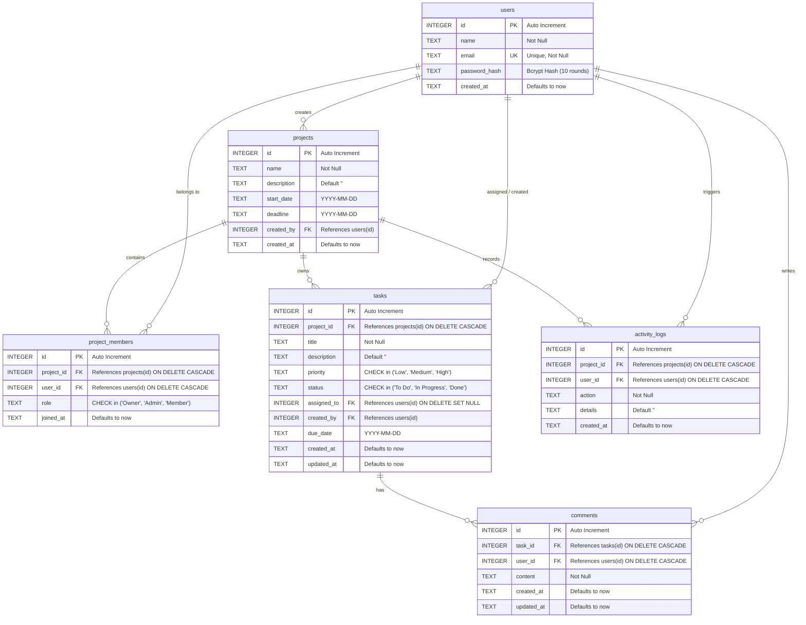
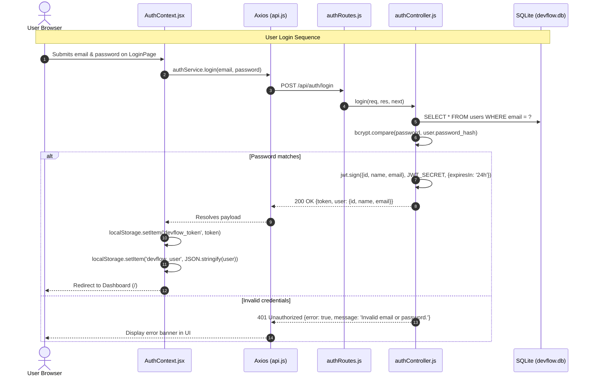

# DevFlow — Full-Stack Project Flow & Architecture Guide

A comprehensive, student-friendly engineering guide explaining the architecture, database flow, authentication, request lifecycle, feature-by-feature execution paths, and college viva preparation for **DevFlow**.

---

## Table of Contents
1. [A. Project Overview](#a-project-overview)
2. [B. Complete Application Architecture](#b-complete-application-architecture)
3. [C. Folder Structure Explained](#c-folder-structure-explained)
4. [D. Database Flow & ER Diagram](#d-database-flow--er-diagram)
5. [E. Authentication Flow](#e-authentication-flow)
6. [F. Complete Feature-by-Feature Execution Flow](#f-complete-feature-by-feature-execution-flow)
   - [1. User Registration & Login](#1-user-registration--login)
   - [2. Creating a Project](#2-creating-a-project)
   - [3. Adding a Team Member](#3-adding-a-team-member)
   - [4. Creating a Task](#4-creating-a-task)
   - [5. Assigning a Task](#5-assigning-a-task)
   - [6. Moving a Task between Kanban Columns](#6-moving-a-task-between-kanban-columns)
   - [7. Adding, Editing, and Deleting a Comment](#7-adding-editing-and-deleting-a-comment)
   - [8. Updating Project Progress Percentage](#8-updating-project-progress-percentage)
   - [9. Recording and Displaying Activity History](#9-recording-and-displaying-activity-history)
7. [G. Complete REST API Documentation](#g-complete-rest-api-documentation)
8. [H. Important Code Explained](#h-important-code-explained)
9. [I. Authorization and Security Mechanisms](#i-authorization-and-security-mechanisms)
10. [J. How to Run the Project Locally](#j-how-to-run-the-project-locally)
11. [K. Suggested Two-Person Team Work Division](#k-suggested-two-person-team-work-division)
12. [L. Step-by-Step College Demonstration Script](#l-step-by-step-college-demonstration-script)
13. [M. 15+ College Viva Questions & Answers](#m-15-college-viva-questions--answers)

---

## A. Project Overview

### What DevFlow Does
**DevFlow** is a modern project management workspace designed for student teams and agile software development teams. Inspired by developer tools like Linear, Jira, and Notion, DevFlow provides:
- Centralized project workspaces.
- Real-time visual **Kanban task boards** (To Do, In Progress, Done) supporting HTML5 drag-and-drop.
- Team member collaboration with role-based access (**Owner**, **Admin**, **Member**).
- Task-level threaded comments and discussions.
- Live progress indicators computed from actual database records.
- Comprehensive audit trails recording project activities.
- A centralized dashboard providing statistics across all projects.

### Problem It Solves
Small software teams often suffer from scattered communication across chat apps and confusing to-do lists that lack deadlines, ownership, and audit trails. DevFlow solves this by giving teams an integrated, self-hosted workspace with role security, progress visualization, and task accountability.

### High-Level Operation
1. The user logs in via a React web client.
2. The client transmits requests using Axios with a JWT token in the `Authorization` header.
3. Express routes requests through authentication and project membership authorization middleware.
4. Controllers execute parameterized SQL queries against an embedded SQLite database using `better-sqlite3`.
5. Audit events are recorded in `activity_logs`.
6. JSON responses update React component state, refreshing the UI instantly.

---

## B. Complete Application Architecture

```mermaid
flowchart TD
    subgraph Browser["Client Layer (React + Vite)"]
        UI["React Components / Pages"]
        Router["React Router DOM (v6)"]
        Context["AuthContext & ToastContext"]
        AxiosClient["Axios API Client (services/api.js)"]
        UI --> Router
        Router --> Context
        Context --> AxiosClient
    end

    subgraph Proxy["Development Proxy"]
        ViteProxy["Vite Proxy (/api -> :5000)"]
    end

    subgraph Backend["Server Layer (Node.js + Express)"]
        Server["Express HTTP Server (server.js / app.js)"]
        GlobalMW["CORS, express.json(), Logging"]
        AuthMW["auth.js (JWT Verification)"]
        RoleMW["authorize.js (Membership / Role Guard)"]
        Controllers["Controllers (project, task, comment, etc.)"]
        ActivityService["services/activityLogger.js"]
        ErrorHandler["middleware/errorHandler.js"]

        Server --> GlobalMW
        GlobalMW --> AuthMW
        AuthMW --> RoleMW
        RoleMW --> Controllers
        Controllers --> ActivityService
        Controllers -.->|next(err)| ErrorHandler
    end

    subgraph Database["Database Layer (SQLite)"]
        SQLiteEngine["better-sqlite3 (WAL Mode + FK Enforced)"]
        DBFile[("devflow.db (SQLite Database File)")]
        SQLiteEngine <--> DBFile
    end

    AxiosClient --> ViteProxy
    ViteProxy --> Server
    Controllers <--> SQLiteEngine
    ActivityService --> SQLiteEngine
```

---

## C. Folder Structure Explained

```
DevFlow_fullstack_project/
├── client/                           # Frontend React Application
│   ├── public/
│   │   └── devflow-icon.svg          # Application browser favicon
│   ├── src/
│   │   ├── components/
│   │   │   ├── common/               # Generic UI building blocks
│   │   │   │   ├── Avatar.jsx        # Initials-based user profile avatar
│   │   │   │   ├── Badge.jsx         # Status, priority, and role pills
│   │   │   │   ├── Button.jsx        # Reusable button with loading spinner
│   │   │   │   ├── EmptyState.jsx    # Clean fallback when lists are empty
│   │   │   │   ├── Icons.jsx         # Custom SVG icon set (zero external icon deps)
│   │   │   │   ├── Input.jsx         # Form input & textarea with error labels
│   │   │   │   ├── Loader.jsx        # Centered loading spinner
│   │   │   │   ├── Modal.jsx         # Accessible backdrop dialog with ESC support
│   │   │   │   └── ProgressBar.jsx   # Visual task completion percentage bar
│   │   │   ├── layout/               # Persistent application frame
│   │   │   │   ├── AppLayout.jsx     # Master layout: Sidebar + TopBar + content slot
│   │   │   │   ├── Sidebar.jsx       # Workspace navigation and quick user logout
│   │   │   │   └── TopBar.jsx        # Dynamic page title and profile snippet
│   │   │   ├── dashboard/
│   │   │   │   └── StatCard.jsx      # Metrics cards (Total Projects, Tasks, etc.)
│   │   │   ├── projects/
│   │   │   │   ├── ProjectCard.jsx   # Project summary card with progress bar
│   │   │   │   └── ProjectModal.jsx  # Modal dialog for creating and editing projects
│   │   │   ├── kanban/
│   │   │   │   ├── KanbanBoard.jsx   # 3-column board layout (To Do, In Progress, Done)
│   │   │   │   ├── KanbanColumn.jsx  # Column container with dropzone listener
│   │   │   │   └── TaskCard.jsx      # Draggable task card with priority and due date
│   │   │   ├── tasks/
│   │   │   │   ├── TaskModal.jsx     # Form for creating/editing tasks with assignees
│   │   │   │   └── TaskDetailModal.jsx # Full-view dialog with comments and metadata
│   │   │   ├── team/
│   │   │   │   ├── MemberList.jsx    # Table of project members with role controls
│   │   │   │   └── AddMemberModal.jsx# Form to invite member by email
│   │   │   ├── comments/
│   │   │   │   ├── CommentItem.jsx   # Single comment item with inline edit & delete
│   │   │   │   └── CommentList.jsx   # Chronological comment feed with input box
│   │   │   └── activity/
│   │   │       └── ActivityTimeline.jsx # Audit log feed with user attribution
│   │   ├── context/
│   │   │   ├── AuthContext.jsx       # User state, JWT storage, login, register, logout
│   │   │   └── ToastContext.jsx      # Non-blocking success/error popups
│   │   ├── pages/
│   │   │   ├── DashboardPage.jsx     # Workspace overview with aggregate statistics
│   │   │   ├── LoginPage.jsx         # Sign-in form with 1-click demo accounts
│   │   │   ├── NotFoundPage.jsx      # 404 page with return link
│   │   │   ├── ProfilePage.jsx       # User profile details and assigned tasks list
│   │   │   ├── ProjectsPage.jsx      # Searchable grid of user projects
│   │   │   ├── ProjectWorkspace.jsx  # Multi-tab project workspace (Board, Tasks, Team, Activity)
│   │   │   └── RegisterPage.jsx      # Sign-up form with password validation
│   │   ├── services/                 # Centralized Axios API callers
│   │   │   ├── activityService.js    # /api/projects/:id/activity
│   │   │   ├── api.js                # Axios client with JWT interceptor & 401 handler
│   │   │   ├── authService.js        # /api/auth/*
│   │   │   ├── commentService.js     # /api/tasks/:id/comments & /api/comments/:id
│   │   │   ├── dashboardService.js   # /api/dashboard
│   │   │   ├── memberService.js      # /api/projects/:id/members
│   │   │   ├── projectService.js     # /api/projects/*
│   │   │   └── taskService.js        # /api/tasks/* and /api/projects/:id/tasks
│   │   ├── utils/
│   │   │   └── helpers.js            # Date formatting, relative time, colors, initials
│   │   ├── App.jsx                   # React Router route declarations & protected route guards
│   │   ├── index.css                 # Dark theme design system, CSS tokens, resets
│   │   └── main.jsx                  # React DOM entry point with Providers
│   ├── index.html                    # Root HTML file
│   ├── package.json                  # Frontend dependencies
│   └── vite.config.js                # Vite build config with backend API proxy
│
├── server/                           # Backend Express & SQLite Application
│   ├── config/
│   │   ├── auth.js                   # JWT secret and token expiration configuration
│   │   └── db.js                     # better-sqlite3 connection with WAL mode & foreign keys
│   ├── controllers/                  # Business logic and SQL execution
│   │   ├── activityController.js     # Audit log queries
│   │   ├── authController.js         # User registration, login, profile retrieval
│   │   ├── commentController.js      # Comment CRUD with author security checks
│   │   ├── dashboardController.js    # Aggregated metrics calculation queries
│   │   ├── memberController.js       # Adding and removing project members
│   │   ├── projectController.js      # Project CRUD with transaction on creation
│   │   └── taskController.js         # Task CRUD and status transition handling
│   ├── database/
│   │   ├── init.js                   # DDL table creation and indexing script
│   │   ├── seed.js                   # Demo data seeder (users, projects, tasks, comments)
│   │   └── devflow.db                # SQLite database file
│   ├── middleware/
│   │   ├── auth.js                   # JWT Bearer token authentication guard
│   │   ├── authorize.js              # Project membership and role-based access checks
│   │   ├── errorHandler.js           # Centralized JSON error responder
│   │   └── validate.js               # Input validation and sanitization helpers
│   ├── routes/                       # Express router definitions
│   │   ├── activityRoutes.js         # /api/projects/:projectId/activity
│   │   ├── authRoutes.js             # /api/auth
│   │   ├── commentRoutes.js          # /api/comments & task comments
│   │   ├── dashboardRoutes.js        # /api/dashboard
│   │   ├── memberRoutes.js           # /api/projects/:projectId/members
│   │   ├── projectRoutes.js          # /api/projects
│   │   └── taskRoutes.js             # /api/tasks & project tasks
│   ├── services/
│   │   └── activityLogger.js         # Helper to record events into activity_logs
│   ├── app.js                        # Express setup, CORS, routes, static client serving
│   ├── server.js                     # Entry point: DB initialization and port listener
│   ├── test-backend.js               # 35-assertion automated integration test suite
│   ├── package.json                  # Backend dependencies
│   └── .env                          # Server environment variables
│
├── BACKEND_FLOW.md                   # Backend specification document
├── PROJECT_FLOW.md                   # This master documentation file
└── README.md                         # Quick-start instructions and project summary
```

---

## D. Database Flow & ER Diagram

DevFlow uses **SQLite** managed through the high-performance `better-sqlite3` library. The database operates with **Foreign Keys enforced** (`PRAGMA foreign_keys = ON`) and **Write-Ahead Logging** (`PRAGMA journal_mode = WAL`) for concurrent reads and writes.



### Table Relationships and Integrity Rules:
1. **Cascade Deletions**:
   - When a project is deleted (`DELETE FROM projects WHERE id = ?`), SQLite automatically cascades the deletion to all associated records in `project_members`, `tasks`, and `activity_logs`.
   - When a task is deleted (`DELETE FROM tasks WHERE id = ?`), SQLite cascades the deletion to its `comments`.
2. **Orphan Prevention (`ON DELETE SET NULL`)**:
   - If a member is deleted from the system, their assigned tasks do not vanish; instead, `tasks.assigned_to` is automatically set to `NULL`, leaving the task visible as **Unassigned**.
3. **Compound Indexes**:
   - `idx_project_members_project_user` on `(project_id, user_id)` allows instantaneous verification of membership permissions on every single HTTP request.
   - `idx_tasks_project` on `tasks(project_id)` accelerates board rendering.
   - `idx_tasks_assigned` on `tasks(assigned_to)` powers the user's personal task list on the dashboard.

---

## E. Authentication Flow

Authentication uses **JSON Web Tokens (JWT)** and **bcrypt** password hashing. The flow is stateless: the server does not store active sessions in memory, allowing quick local restarts.



### How the Backend Identifies the Authenticated User:
1. When the user logs in, the backend sends a JWT signed with `JWT_SECRET`.
2. The browser stores this token in `localStorage`.
3. In `client/src/services/api.js`, an Axios request interceptor attaches the token to every request:
   ```javascript
   config.headers.Authorization = `Bearer ${token}`;
   ```
4. On the server, `server/middleware/auth.js` intercepts the request:
   ```javascript
   const token = authHeader.split(' ')[1];
   const decoded = jwt.verify(token, JWT_SECRET);
   const user = db.prepare('SELECT id, email, name FROM users WHERE id = ?').get(decoded.id);
   req.user = { id: user.id, email: user.email, name: user.name };
   next();
   ```
5. All downstream controllers securely obtain the user identity through `req.user.id`.

---

## F. Complete Feature-by-Feature Execution Flow

### 1. User Registration & Login
1. **User Action**: The user fills in name, email, password on `RegisterPage.jsx` and clicks "Create Account".
2. **React Component**: `RegisterPage.jsx` validates that passwords match and calls `register()` from `AuthContext.jsx`.
3. **Axios Request**: `authService.register` sends `POST /api/auth/register` with `{ name, email, password }`.
4. **Express Route**: `authRoutes.js` receives `POST /register` and calls `authController.register`.
5. **Controller**: `authController.js` validates email syntax, checks for duplicate email, hashes password with `bcrypt.hash(password, 10)`, and runs SQL insert.
6. **SQL Query**:
   ```sql
   INSERT INTO users (name, email, password_hash) VALUES (?, ?, ?);
   ```
7. **Backend Response**: Returns `201 Created` with a newly generated JWT token and `{ id, name, email }`.
8. **UI Update**: `AuthContext.jsx` saves token and user in `localStorage`, sets `isAuthenticated = true`, and redirects to Dashboard.

---

### 2. Creating a Project
1. **User Action**: User clicks "New Project" on `ProjectsPage.jsx`, fills in project name, description, deadline, and clicks "Create Project".
2. **React Component**: `ProjectModal.jsx` passes form data to `ProjectsPage.jsx` handler `handleSubmitProject`.
3. **Axios Request**: `projectService.createProject` sends `POST /api/projects` with `{ name, description, start_date, deadline }`.
4. **Express Route**: `projectRoutes.js` authenticates the token via `auth.js` and calls `projectController.createProject`.
5. **Controller**: `projectController.js` opens a database transaction (`db.transaction()`) so project creation and owner membership assignment happen atomically.
6. **SQL Queries**:
   ```sql
   -- Insert project
   INSERT INTO projects (name, description, start_date, deadline, created_by) VALUES (?, ?, ?, ?, ?);
   -- Automatically assign creator as Owner
   INSERT INTO project_members (project_id, user_id, role) VALUES (?, ?, 'Owner');
   -- Log project creation
   INSERT INTO activity_logs (project_id, user_id, action, details) VALUES (?, ?, 'Created project', ?);
   ```
7. **Backend Response**: Returns `201 Created` with the full project object including `role: 'Owner'`.
8. **UI Update**: `ProjectsPage.jsx` receives the new project, prepends it to the project list, closes the modal, and shows a green success toast notification.

---

### 3. Adding a Team Member
1. **User Action**: An Owner or Admin opens the "Team" tab in `ProjectWorkspace.jsx`, clicks "Add Member", enters `bob@devflow.com`, selects role "Admin", and clicks "Add Member".
2. **React Component**: `AddMemberModal.jsx` sends values to `ProjectWorkspace.jsx` handler `handleAddMember`.
3. **Axios Request**: `memberService.addMember(projectId, { email, role })` triggers `POST /api/projects/:projectId/members`.
4. **Express Route**: `memberRoutes.js` passes through `authenticate` and `requireProjectRole('Owner', 'Admin')` to `memberController.addMember`.
5. **Controller**: `memberController.js` finds user by email, verifies they are not already in `project_members`, and inserts the membership record.
6. **SQL Queries**:
   ```sql
   SELECT id, name, email FROM users WHERE email = ?;
   SELECT id FROM project_members WHERE project_id = ? AND user_id = ?;
   INSERT INTO project_members (project_id, user_id, role) VALUES (?, ?, ?);
   INSERT INTO activity_logs (project_id, user_id, action, details) VALUES (?, ?, 'Added member', ?);
   ```
7. **Backend Response**: Returns `201 Created` with `{ member: { id, project_id, user_id, name, email, role, joined_at } }`.
8. **UI Update**: `ProjectWorkspace.jsx` appends the new member to the `members` state array and increments the member counter in the header.

---

### 4. Creating a Task
1. **User Action**: User clicks "+ New Task" in the workspace, types title "Implement auth tokens", picks Priority "High", Status "To Do", and assigns to Bob.
2. **React Component**: `TaskModal.jsx` validates input and passes values to `handleTaskSubmit`.
3. **Axios Request**: `taskService.createTask(projectId, taskData)` sends `POST /api/projects/:projectId/tasks`.
4. **Express Route**: `taskRoutes.js` checks project membership (`requireProjectMember`) and calls `taskController.createTask`.
5. **Controller**: `taskController.js` checks that `assigned_to` user is an active member of this project, inserts the task, and logs the action.
6. **SQL Queries**:
   ```sql
   SELECT role FROM project_members WHERE project_id = ? AND user_id = ?; -- assignee check
   INSERT INTO tasks (project_id, title, description, priority, status, assigned_to, created_by, due_date)
   VALUES (?, ?, ?, ?, ?, ?, ?, ?);
   INSERT INTO activity_logs (project_id, user_id, action, details) VALUES (?, ?, 'Created task', ?);
   ```
7. **Backend Response**: Returns `201 Created` with task details and resolved `assignee_name`.
8. **UI Update**: Task is added to the Kanban "To Do" column and the workspace tasks list immediately.

---

### 5. Assigning a Task
1. **User Action**: User edits a task or opens `TaskModal.jsx`, changes Assignee dropdown from "Unassigned" to "Alice Johnson", and clicks Save.
2. **React Component**: `TaskModal.jsx` calls `taskService.updateTask(taskId, { assigned_to: aliceId })`.
3. **Axios Request**: Sends `PUT /api/tasks/:taskId` with `{ assigned_to: 1 }`.
4. **Express Route**: `taskRoutes.js` handles `PUT /:taskId` with `taskController.updateTask`.
5. **Controller**: `taskController.js` checks project membership, verifies Alice is in `project_members`, updates `tasks.assigned_to`, and records an activity log entry.
6. **SQL Queries**:
   ```sql
   UPDATE tasks SET assigned_to = ?, updated_at = datetime('now') WHERE id = ?;
   INSERT INTO activity_logs (project_id, user_id, action, details) VALUES (?, ?, 'Assigned task', ?);
   ```
7. **Backend Response**: Returns `200 OK` with updated task details and new `assignee_name`.
8. **UI Update**: The task card re-renders with Alice's avatar pill.

---

### 6. Moving a Task between Kanban Columns
1. **User Action**: User drags a task card from "To Do" and drops it into "In Progress" (or selects "In Progress" from the status dropdown).
2. **React Component**: `TaskCard.jsx` sets `dataTransfer` with the task ID. `KanbanColumn.jsx` receives `onDrop` and fires `handleStatusChange(taskId, 'In Progress')`.
3. **Optimistic UI**: `ProjectWorkspace.jsx` moves the card into "In Progress" instantaneously so the UI feels fast.
4. **Axios Request**: `taskService.updateTask(taskId, { status: 'In Progress' })` sends `PUT /api/tasks/:taskId`.
5. **Express Route**: `taskRoutes.js` passes request to `taskController.updateTask`.
6. **Controller**: Detects that `newStatus !== existing.status`, updates the database, and records an activity entry.
7. **SQL Queries**:
   ```sql
   UPDATE tasks SET status = ?, updated_at = datetime('now') WHERE id = ?;
   INSERT INTO activity_logs (project_id, user_id, action, details) VALUES (?, ?, 'Updated task status', ?);
   ```
8. **Backend Response**: Returns `200 OK` with the updated task record.
9. **UI Update**: Task stays in "In Progress", and the project header's completion progress bar recalculates automatically.

---

### 7. Adding, Editing, and Deleting a Comment
1. **User Action**: User clicks a task card to open `TaskDetailModal.jsx`, enters a comment in `CommentList.jsx`, and clicks "Comment".
2. **React Component**: `CommentList.jsx` calls `commentService.addComment(taskId, content)`.
3. **Axios Request**: Sends `POST /api/tasks/:taskId/comments` with `{ content }`.
4. **Express Route**: `commentRoutes.js` forwards to `commentController.addComment`.
5. **Controller**: `commentController.js` ensures the user is a member of the project that owns the task, inserts the comment, and records activity.
6. **SQL Queries**:
   ```sql
   INSERT INTO comments (task_id, user_id, content) VALUES (?, ?, ?);
   INSERT INTO activity_logs (project_id, user_id, action, details) VALUES (?, ?, 'Added comment', ?);
   ```
7. **Backend Response**: Returns `201 Created` with the new comment and `author_name`.
8. **UI Update**: Comment appears immediately at the bottom of the chronological list.
9. **Author-Only Edit/Delete**: For comments where `comment.user_id === user.id`, Edit and Delete buttons are rendered. If another user attempts `PUT /api/comments/:commentId` directly, the backend checks `comment.user_id !== req.user.id` and returns `403 Forbidden`.

---

### 8. Updating Project Progress Percentage
1. **How It Works**: Progress is not hardcoded. Every time tasks change status, progress is computed dynamically.
2. **SQL Calculation**:
   ```sql
   SELECT 
     COUNT(*) AS total_tasks,
     SUM(CASE WHEN status = 'Done' THEN 1 ELSE 0 END) AS completed_tasks
   FROM tasks WHERE project_id = ?;
   ```
3. **Formula**:
   $$\text{Progress} = \text{total\_tasks} > 0 \;?\; \text{round}\left(\frac{\text{completed\_tasks}}{\text{total\_tasks}} \times 100\right) : 0$$
4. **UI Update**: Rendered visually using `ProgressBar.jsx` in both the project card and project workspace header.

---

### 9. Recording and Displaying Activity History
1. **Automatic Trigger**: Any mutating operation (project created, task created, status changed, comment added, member added/removed) invokes `logActivity(projectId, userId, action, details)` from `server/services/activityLogger.js`.
2. **SQL Query**:
   ```sql
   INSERT INTO activity_logs (project_id, user_id, action, details) VALUES (?, ?, ?, ?);
   ```
3. **Retrieval**: `ActivityTimeline.jsx` fetches `GET /api/projects/:projectId/activity`.
4. **Display**: Displays user name, action type with customized color icon, details, and relative time (e.g. "5m ago").

---

## G. Complete REST API Documentation

| Method | Endpoint | Auth | Role Required | Request Body / Query | Success Response | Error Codes |
|---|---|---|---|---|---|---|
| `GET` | `/api/health` | No | None | None | `{ status: 'ok', service: 'DevFlow API Server' }` | None |
| `POST` | `/api/auth/register` | No | None | `{ name, email, password }` | `201` `{ success, token, user }` | 400, 409 |
| `POST` | `/api/auth/login` | No | None | `{ email, password }` | `200` `{ success, token, user }` | 400, 401 |
| `GET` | `/api/auth/me` | Yes | Any | None | `200` `{ success, user }` | 401, 404 |
| `GET` | `/api/projects` | Yes | Member | None | `200` `{ success, projects: [...] }` | 401 |
| `POST` | `/api/projects` | Yes | Any | `{ name, description, start_date, deadline }` | `201` `{ success, project }` | 400, 401 |
| `GET` | `/api/projects/:projectId` | Yes | Member | None | `200` `{ success, project }` | 401, 403, 404 |
| `PUT` | `/api/projects/:projectId` | Yes | Owner, Admin | `{ name, description, start_date, deadline }` | `200` `{ success, project }` | 400, 403, 404 |
| `DELETE` | `/api/projects/:projectId` | Yes | Owner | None | `200` `{ success, message }` | 403, 404 |
| `GET` | `/api/projects/:projectId/members` | Yes | Member | None | `200` `{ success, members: [...] }` | 403, 404 |
| `POST` | `/api/projects/:projectId/members` | Yes | Owner, Admin | `{ email, role }` | `201` `{ success, member }` | 400, 403, 404, 409 |
| `DELETE` | `/api/projects/:projectId/members/:userId` | Yes | Owner, Admin | None | `200` `{ success, message }` | 403, 404 |
| `GET` | `/api/projects/:projectId/tasks` | Yes | Member | `?status=&priority=&assigned_to=` | `200` `{ success, tasks: [...] }` | 403, 404 |
| `POST` | `/api/projects/:projectId/tasks` | Yes | Member | `{ title, description, priority, status, assigned_to, due_date }` | `201` `{ success, task }` | 400, 403, 404 |
| `GET` | `/api/tasks/:taskId` | Yes | Member | None | `200` `{ success, task }` | 403, 404 |
| `PUT` | `/api/tasks/:taskId` | Yes | Member | `{ title, description, priority, status, assigned_to, due_date }` | `200` `{ success, task }` | 400, 403, 404 |
| `DELETE` | `/api/tasks/:taskId` | Yes | Member | None | `200` `{ success, message }` | 403, 404 |
| `GET` | `/api/tasks/:taskId/comments` | Yes | Member | None | `200` `{ success, comments: [...] }` | 403, 404 |
| `POST` | `/api/tasks/:taskId/comments` | Yes | Member | `{ content }` | `201` `{ success, comment }` | 400, 403, 404 |
| `PUT` | `/api/comments/:commentId` | Yes | Author | `{ content }` | `200` `{ success, comment }` | 400, 403, 404 |
| `DELETE` | `/api/comments/:commentId` | Yes | Author | None | `200` `{ success, message }` | 403, 404 |
| `GET` | `/api/dashboard` | Yes | Any | None | `200` `{ success, stats, my_tasks, recent_projects, recent_activity }` | 401 |
| `GET` | `/api/projects/:projectId/activity` | Yes | Member | `?limit=25&offset=0` | `200` `{ success, total, activities: [...] }` | 403, 404 |

---

## H. Important Code Explained

### 1. Database Transactions on Project Creation (`server/controllers/projectController.js`)
```javascript
const createTx = db.transaction(() => {
  const insertProj = db.prepare(`
    INSERT INTO projects (name, description, start_date, deadline, created_by)
    VALUES (?, ?, ?, ?, ?)
  `);
  const projResult = insertProj.run(cleanName, cleanDesc, start_date || null, deadline || null, userId);
  const projectId = Number(projResult.lastInsertRowid);

  // Automatically insert creator as Owner
  db.prepare(`
    INSERT INTO project_members (project_id, user_id, role)
    VALUES (?, ?, 'Owner')
  `).run(projectId, userId);

  // Log activity
  logActivity(projectId, userId, 'Created project', `Project "${cleanName}" was created`);

  return projectId;
});
```
**Why this matters**: A transaction guarantees atomicity. If adding the membership or activity log fails, the project is not created, preventing orphaned projects with no owner.

---

### 2. Project Membership Authorization Middleware (`server/middleware/authorize.js`)
```javascript
function requireProjectMember(req, res, next) {
  const projectId = req.params.projectId;
  const member = db
    .prepare('SELECT role FROM project_members WHERE project_id = ? AND user_id = ?')
    .get(projectId, req.user.id);

  if (!member) {
    return res.status(403).json({
      error: true,
      message: 'You are not a member of this project.',
    });
  }

  req.memberRole = member.role;
  next();
}
```
**Why this matters**: It acts as a security guard. Even if a user has a valid login token, they are completely blocked from viewing or mutating another team's project.

---

### 3. Drag and Drop with HTML5 (`client/src/components/kanban/TaskCard.jsx`)
```javascript
const handleDragStart = (e) => {
  e.dataTransfer.setData('text/plain', String(task.id));
  e.dataTransfer.effectAllowed = 'move';
};
```
In `KanbanColumn.jsx`:
```javascript
const handleDrop = (e) => {
  e.preventDefault();
  const taskId = Number(e.dataTransfer.getData('text/plain'));
  onStatusChange(taskId, status); // e.g. 'In Progress'
};
```
**Why this matters**: Native HTML5 Drag and Drop avoids hefty external libraries (such as `react-beautiful-dnd`) while providing fluid card movement between columns.

---

## I. Authorization and Security Mechanisms

1. **Password Security**: Passwords are never stored in plaintext. They are salted and hashed using `bcrypt` with 10 rounds.
2. **Parameterized SQL Queries**: All queries in DevFlow use prepared statements:
   ```javascript
   db.prepare('SELECT * FROM users WHERE email = ?').get(email);
   ```
   Values are treated strictly as data, making SQL injection impossible.
3. **Role Enforcement**:
   - `Owner`: Full access; can update project settings, add/remove members, and delete the project.
   - `Admin`: Can add/remove regular members, create and edit tasks. Cannot delete the project or remove other Admins/Owners.
   - `Member`: Can view the project, create tasks, update task status, and post comments. Cannot edit project settings or manage members.
4. **Comment Integrity**: Only the user who authored a comment can edit or delete it (`comment.user_id === req.user.id`).
5. **Token Expiry**: JWTs expire after 24 hours. The Axios response interceptor automatically purges expired tokens and prompts the user to log back in.

---

## J. How to Run the Project Locally

### Prerequisites
- Node.js (version 18, 20, 22, or 24)
- npm

### 1. Setup Backend
```powershell
cd c:\Ekansh\DevFlow_fullstack_project\server
npm install
node database/seed.js    # Initializes SQLite schema and creates demo accounts
npm start               # Starts Express server on http://localhost:5000
```

### 2. Setup Frontend
```powershell
cd c:\Ekansh\DevFlow_fullstack_project\client
npm install
npm run dev             # Starts Vite development server on http://localhost:5173
```

Visit **`http://localhost:5173`** in your browser.

> [!TIP]
> **Single-Command Production Mode**:
> If you run `npm run build` in `client/`, Express will automatically serve the compiled frontend directly at **`http://localhost:5000`**!

### Demo Credentials
| Name | Email | Password | Role |
|---|---|---|---|
| **Alice Johnson** | `alice@devflow.com` | `password123` | Owner (DevFlow Platform) |
| **Bob Smith** | `bob@devflow.com` | `password123` | Admin (DevFlow Platform) / Owner (Mobile Redesign) |
| **Charlie Davis** | `charlie@devflow.com` | `password123` | Member (DevFlow Platform) |

---

## K. Suggested Two-Person Team Work Division

For a two-person student team presenting for a Web Technologies or Software Engineering course:

| Student | Assigned Responsibilities | Primary Files Owned |
|---|---|---|
| **Student 1 (Backend & Data Architect)** | Database design, SQLite schema & migrations, REST API design, JWT authentication, role authorization middleware, transactions, activity logging, backend integration test suite. | `server/database/init.js`<br>`server/database/seed.js`<br>`server/middleware/auth.js`<br>`server/middleware/authorize.js`<br>`server/controllers/*`<br>`server/routes/*`<br>`server/test-backend.js` |
| **Student 2 (Frontend & UX Engineer)** | React UI design, Linear/Notion dark styling, Kanban drag-and-drop board, state management (`AuthContext`, `ToastContext`), Axios service client, project workspace tabs, comment discussions. | `client/src/index.css`<br>`client/src/context/*`<br>`client/src/services/*`<br>`client/src/components/kanban/*`<br>`client/src/components/comments/*`<br>`client/src/pages/*` |

---

## L. Step-by-Step College Demonstration Script

Follow this sequence during your project evaluation:

1. **Sign-In & Demo Account Switch**:
   - Open `http://localhost:5173/login`.
   - Show the 1-click demo credential buttons.
   - Click "Alice (Owner / Admin)" and click **Sign In**.
2. **Dashboard Overview**:
   - Show the dynamic statistics grid: Total Projects, Total Tasks, Completed, In Progress, Overdue.
   - Explain to the professor that all metrics are computed from real SQLite records using SQL aggregation queries, not hardcoded dummy data.
   - Point out "Assigned to Me" and "Recent Activity".
3. **Projects Grid & Creation**:
   - Click "Projects" in the sidebar.
   - Click "+ New Project", create "AI Code Reviewer", set a deadline, and submit.
   - Show the new project card appearing with `Owner` badge and 0% progress.
4. **Project Workspace & Kanban Board**:
   - Open "DevFlow Platform".
   - Click the **Board** tab.
   - Demonstrate drag-and-drop: drag a task from "To Do" to "In Progress".
   - Notice the header completion bar and column counter badge update in real-time.
   - Refresh the page to prove that the status update persisted to the SQLite database!
5. **Task Details & Comments**:
   - Click on the task "Implement authentication".
   - Show task details: priority, status, assignee, deadline.
   - Add a comment: *"Tokens verified with 35 unit tests."*
   - Show that Alice can edit or delete her own comment.
6. **Role Permissions & Member Management**:
   - Switch to the **Team** tab.
   - Add an existing user by email: `bob@devflow.com` as Admin.
   - Log out, sign in as `Charlie Davis` (Member).
   - Navigate to the same project: show that Charlie cannot delete the project or remove members because the UI hides those actions and the backend enforces role checks.
7. **Activity History Audit Log**:
   - Switch to the **Activity** tab.
   - Show the chronological audit trail recording every task movement, member addition, and comment with exact timestamps.

---

## M. 15+ College Viva Questions & Answers

### 1. What is the role of SQLite in this application, and why use WAL mode?
**Answer**: SQLite serves as an embedded, zero-configuration relational database stored directly on disk (`devflow.db`). WAL (Write-Ahead Logging) mode allows concurrent readers to continue reading while a writer is modifying the database, eliminating database lock contention common in default journal modes.

### 2. How do you prevent SQL Injection in DevFlow?
**Answer**: All SQL operations use parameterized prepared statements via `better-sqlite3` (e.g. `db.prepare('SELECT * FROM users WHERE email = ?').get(email)`). User input is passed as parameter values rather than concatenated strings, preventing malicious SQL injection.

### 3. How does JWT authentication work, and why is it stateless?
**Answer**: Upon valid login with bcrypt password verification, the server generates a cryptographically signed token containing `{ id, name, email }` using a secret key. The client stores this in `localStorage` and includes it in the `Authorization: Bearer <token>` header for subsequent requests. The server does not maintain session tables in memory; it verifies the signature mathematically on each request.

### 4. What is the difference between Authentication and Authorization in DevFlow?
**Answer**:
- **Authentication** (`auth.js`): Verifies *who you are* by validating the JWT token and checking the user exists in `users`.
- **Authorization** (`authorize.js`): Verifies *what you are allowed to do* by checking your membership and role (`Owner`, `Admin`, `Member`) in `project_members` for the specific project being accessed.

### 5. Why are Foreign Key constraints important, and how are they enabled in SQLite?
**Answer**: By default, SQLite has foreign key enforcement disabled. DevFlow enables it on connection initialization via `db.pragma('foreign_keys = ON')`. This ensures referential integrity; for instance, creating a task referencing a non-existent project fails, and deleting a project automatically cascades to delete all its tasks and comments (`ON DELETE CASCADE`).

### 6. What happens to a task if the assigned user is deleted?
**Answer**: In the database schema, `tasks.assigned_to` specifies `FOREIGN KEY (assigned_to) REFERENCES users(id) ON DELETE SET NULL`. If an assigned user is deleted, the task remains intact in the project, but its assignee resets to `NULL` (displayed as "Unassigned" in the UI), preventing orphaned foreign keys or lost tasks.

### 7. How does the Kanban drag-and-drop persist to the backend?
**Answer**: On `dragStart`, the task ID is placed in `dataTransfer`. When dropped on a column, `onDrop` retrieves the task ID and column status, updates local React state optimistically, and dispatches `PUT /api/tasks/:taskId` with `{ status: newStatus }`. The backend updates the task record and logs the transition in `activity_logs`.

### 8. How does the frontend handle token expiry?
**Answer**: An Axios response interceptor (`services/api.js`) monitors all responses. If an API call returns `401 Unauthorized` (indicating the JWT has expired), the interceptor clears `devflow_token` and `devflow_user` from `localStorage` and redirects the user to `/login?expired=true`.

### 9. Why did you use database transactions during project creation?
**Answer**: Creating a project requires inserting into `projects` AND inserting into `project_members` to assign the creator as `Owner`. Wrapping these queries in `db.transaction()` ensures that both statements either succeed together or rollback together, preventing a project from existing without an owner.

### 10. How is project progress percentage calculated?
**Answer**: Progress is computed dynamically using SQL aggregation:
$$\text{Progress} = \text{round}\left(\frac{\text{completed tasks}}{\text{total tasks}} \times 100\right)$$
If a project has 0 tasks, progress defaults safely to 0%.

### 11. Can a regular Member delete comments written by other members?
**Answer**: No. `commentController.js` validates `comment.user_id === req.user.id`. If a user attempts to edit or delete someone else's comment, the backend returns HTTP `403 Forbidden`.

### 12. What is the purpose of React Context in this project?
**Answer**: React Context eliminates "prop drilling":
- `AuthContext`: Provides the global authenticated user object, login, register, and logout methods to any component.
- `ToastContext`: Provides a global `showToast(message, type)` function callable from any page or modal to trigger notifications.

### 13. What is Vite proxy and why was it configured?
**Answer**: In `vite.config.js`, a proxy redirects `/api` requests to `http://localhost:5000`. This avoids Cross-Origin Resource Sharing (CORS) complications during development and allows the frontend to request relative paths like `/api/projects`.

### 14. What are React Protected Routes and how are they implemented?
**Answer**: `ProtectedRoute` in `App.jsx` inspects `isAuthenticated` from `AuthContext`. If false, it returns `<Navigate to="/login" replace />`, blocking unauthenticated visitors from viewing the workspace.

### 15. How does the server prevent two users from registering with the same email?
**Answer**: The `users.email` column has a `UNIQUE` constraint in SQLite, and `authController.js` explicitly checks `SELECT id FROM users WHERE email = ?` before insertion, returning HTTP `409 Conflict` if the email is already registered.

### 16. What is the difference between `PUT` and `PATCH` in REST APIs?
**Answer**: `PUT` typically replaces the resource or updates all/most of its fields, while `PATCH` applies partial modifications. In DevFlow, `PUT /api/tasks/:taskId` supports updating both individual fields (like status) or the complete task definition.
